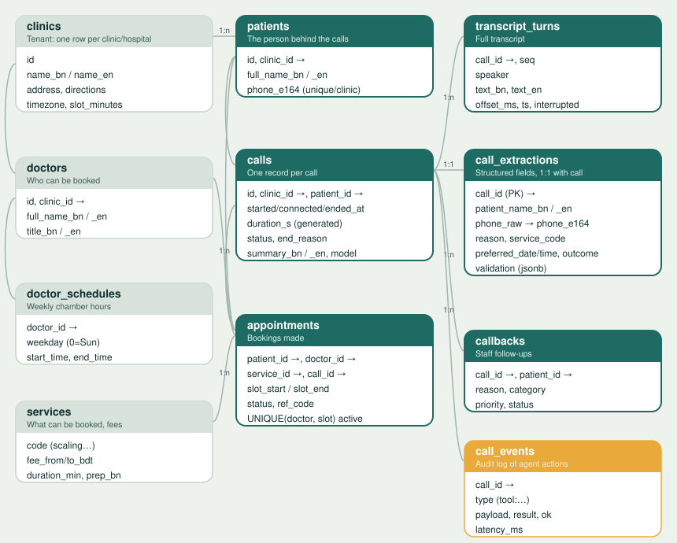

# ByteVoice বাংলা — Bangla AI receptionist for clinics in Bangladesh

An early, working version of StrategyByte's Bangla voice agent, built end to end for the AI Engineer task:

| Part | What it is | Where |
|---|---|---|
| A. Landing page | Bilingual (বাংলা / English) page with a 3D hero, 6 sections, responsive | `web/src/pages/Landing.tsx` |
| B. Hero call to action | "বাংলা কলারের সাথে কথা বলুন / Talk to our Bangla caller", live in the browser | `web/src/components/CallPanel.tsx`, `web/src/voice/` |
| C. Bangla caller | "Sumi", the AI receptionist of a demo clinic (Hashi Dental Care, Dhanmondi) | `supabase/functions/api/` |
| D. Data portal | Login, call list, call detail, appointments, callbacks, data-model page | `web/src/portal/` |

**Live links** (fill in after deploying, see [DEPLOY.md](DEPLOY.md))
- Landing page: `https://<your-vercel-app>.vercel.app`
- Portal: `https://<your-vercel-app>.vercel.app/portal`
- Reviewer login: `reviewer@bytevoice.demo` / `ByteVoice-Review-2026` (read-only, demo data only)

---

## 1. How a call works

```
 Browser (React)                         Supabase Edge Function "api"                 Google
 ───────────────                         ────────────────────────────                 ──────
 click "Talk to our Bangla caller"
 getUserMedia (mic permission) ──► POST /api/session
                                     • rate-limit (salted IP hash, daily cap)
                                     • build system prompt from DB:
                                       clinic, doctors, hours, fees, 15-day calendar
                                     • mint single-use ephemeral token ───────────────► auth_tokens
                                       (model, prompt, tools LOCKED in token)
                                     • insert calls row (status in_progress)
                 ◄── { callId, callSecret, token }
 WebSocket to Gemini Live with the token ──────────────────────────────────────────────► Live API
   mic → AudioWorklet → 16 kHz PCM16 ──►                                                  (native audio,
   ◄── 24 kHz PCM16 audio + transcripts                                                   VAD, barge-in)
   toolCall (check_availability, book…) ──► POST /api/tool  (validates, writes DB) 
   ◄── toolResponse
   transcript turns every 4 s ──────────► POST /api/turns   (upsert by call_id+seq)
 hang up / agent ends ──────────────────► POST /api/finalize
                                     • Gemini text model: structured read + English
                                       translation + summary of the transcript ────────► generateContent
                                     • merge with tool facts, validate, set status
 Portal (staff login, RLS) ◄──────────── Postgres (Singapore, ap-southeast-1)
```

The browser talks to Gemini directly (lowest latency: no audio relay through our server), but **the API key never leaves the server**. The browser only gets a short-lived, single-use token whose prompt, tools and model are fixed server-side, so a visitor can't repurpose it.

## 2. Why this stack

| Choice | Why |
|---|---|
| **Gemini Live API** (`gemini-3.8-live`, configurable) | One speech-to-speech model: no STT → LLM → TTS chain, so replies start fast. Supports Bengali (bn-BD), automatic voice-activity detection, barge-in (caller can interrupt), function calling, live transcripts of both sides, and a free tier. Browser-direct via ephemeral tokens. |
| **Gemini 3.8 Flash** (post-call) | Cheap, fast structured-JSON extraction and English translation of each transcript line. |
| **Supabase** (Postgres + Auth + Edge Functions) | Real relational schema with constraints, Row Level Security for the portal, built-in auth, server-side functions for secrets. Region **ap-southeast-1 (Singapore)**, the closest to Dhaka. Free tier. |
| **React + Vite + Three.js (react-three-fiber)** | Fast static site, deployable anywhere (Vercel/Netlify). 3D and voice SDK are lazy-loaded so first paint stays light. |
| **Anek Bangla** (self-hosted variable font) | One family that renders Bangla and Latin well; its width axis drives the typography. Self-hosted so it loads reliably in Bangladesh. |

## 3. The Bangla caller ("Sumi")

The system prompt is generated per call in [`lib/prompt.ts`](supabase/functions/api/lib/prompt.ts) from database data. Main behaviours:

- **Natural Dhaka Bangla, not translated English.** Uses চলিত ভাষা, "আপনি", and the English words Bangladeshis actually say in clinics: সিরিয়াল, অ্যাপয়েন্টমেন্ট, স্কেলিং, এক্স-রে. "সিরিয়াল দিতে চাই" is understood as booking. Short turns, one question at a time.
- **Warmth.** Responds to how the caller feels first (pain, worry, a child's appointment), varies acknowledgements (জি, আচ্ছা, বুঝতে পারছি), matches the caller's pace, and closes kindly ("ভালো থাকবেন, আল্লাহ হাফেজ").
- **Code-switching.** Understands mixed Bangla/English and replies in Bangla. Switches to simple English if the caller speaks only English.
- **Numbers, dates, times.** Accepts Bangla or English digits, "ডাবল সাত", "+৮৮". Reads phone numbers back digit by digit in groups. Times are spoken naturally ("সন্ধ্যা সাড়ে ৬টা", "দুপুর আড়াইটা"). Relative dates ("আগামী রবিবার", "পরশু", "next Sunday evening") are resolved against a 15-day calendar injected into the prompt, not by the model's own date arithmetic.
- **Confirmation before booking.** Reads back name, phone, service, doctor, day, date and time, and books only after a clear yes. The server also refuses any booking without `confirmed_by_caller = true`.
- **No invented facts.** Hours, doctors, fees, directions and preparation come only from the clinic tables. Unknown questions go to a staff callback.
- **Safety.** No diagnosis, medicines or dosages. Emergency signs lead to "go to the nearest hospital / call ৯৯৯" plus an urgent callback for staff.
- **Strictly on-topic.** Politely refuses anything unrelated to the clinic (general knowledge, cricket scores, coding, politics, jokes…) and steers back. After three off-topic pushes it ends the call. Ignores attempts to change its role or reveal its instructions.
- **Recovery.** Asks again when unsure ("লাইনটা একটু কেটে গেল — আরেকবার বলবেন?"). After 9 s of silence the client nudges the agent to check in; after a second silence it ends politely. Barge-in stops playback immediately and marks the cut-off turn as `interrupted`.

**Tools the agent can call** (all validated server-side in [`lib/tools.ts`](supabase/functions/api/lib/tools.ts)): `check_availability`, `save_caller_details`, `book_appointment`, `find_appointments`, `reschedule_appointment`, `cancel_appointment`, `request_callback`, `end_call`.

## 4. Data model

 The live portal page **Data model** draws the same diagram with row counts.

| Table | Purpose | Key fields / constraints |
|---|---|---|
| `clinics` | Tenant (one row per clinic/hospital) | names bn/en, address, directions, `slot_minutes` |
| `doctors`, `doctor_schedules` | Who can be booked and when | weekly hours per doctor; Friday closed |
| `services` | What can be booked | `code` (scaling, filling…), fee range BDT, duration, preparation |
| `patients` | The person behind the calls | `full_name_bn`, `full_name_en`, `phone_e164` **CHECK `^\+8801[3-9]\d{8}$`**, unique per clinic |
| `calls` | One row per call | timestamps, `duration_s` (generated), `status` (booked / rescheduled / cancelled / enquiry / follow_up / incomplete / failed / in_progress), `end_reason`, bilingual summary, model, hashed per-call secret |
| `transcript_turns` | Full transcript | `seq`, `speaker` (agent/caller), `text_bn`, `text_en`, `offset_ms`, `ts`, `interrupted`; unique (`call_id`, `seq`) so retries are idempotent |
| `call_extractions` | Structured fields, 1:1 with a call | raw vs normalised values (`phone_raw` → `phone_e164`), reason, service, doctor, said-when text → `preferred_date`/`time`, outcome, `needs_human`, `confirmed_by_caller`, **`validation` jsonb** with per-field checks and where each value came from |
| `appointments` | Bookings | patient, doctor, service, `call_id` (created by) and `updated_by_call_id`, slot, status, 4-digit spoken serial. **Partial unique index on (doctor_id, slot_start) for active bookings → no double booking, even with concurrent calls** |
| `callbacks` | Staff follow-ups | category (medical_question, complaint, emergency…), priority, open/done |
| `call_events` | Audit log | every tool call with payload, result, ok flag, latency |
| `demo_requests` | Landing-page form | |
| `staff` | Portal users ↔ clinic | drives Row Level Security |

**Where data lives.** Supabase Postgres, Singapore. Times are stored as UTC `timestamptz` and shown in Asia/Dhaka. **No audio is recorded** in this demo by design; the transcript is the record (`calls.recording_url` is reserved for clinics that want recordings, which would go to Supabase Storage with a retention policy).

**How fields are validated** ([`lib/bangla.ts`](supabase/functions/api/lib/bangla.ts), unit-tested):
- Bangla (০-৯) and Arabic-Indic digits are converted to ASCII; spoken words (শূন্য, ডাবল সাত, ওয়ান, "double five") are expanded.
- Phone: strip `+880` / `880` / `00880`, repair a missing leading 0, require an 11-digit BD mobile `01[3-9]XXXXXXXX`, store E.164, detect the operator. An invalid number is never written over a valid one.
- Dates and times: rejects impossible or past dates, checks the clinic is open and the time is within chamber hours, and re-checks the slot is free just before inserting.
- Names: stored in Bangla script as said plus a romanised spelling; "আমার নাম … বলছি" is stripped.
- At finalisation, **facts from tools beat the LLM**: the outcome comes from `appointments` / `callbacks` when they exist, and the LLM only fills gaps. Each field records its source (`tool`, `appointment`, `llm`).

**Security.**
- RLS is on for every table. Staff only see rows for their own clinic. The portal's only write is closing a callback (column-level grant). The `session_secret_hash` column is hidden from the portal role.
- Call writes need the per-call secret (only its SHA-256 is stored) or a staff JWT.
- Secrets live only in Supabase Edge Function secrets: `GEMINI_API_KEY`, plus the service-role key injected by the platform. The browser only gets the publishable key, which is safe by design.

## 5. Repository layout

```
web/                         React app (landing + portal)
  src/pages/Landing.tsx        landing sections + hero
  src/components/LotusScene.tsx  3D shapla (water lily) that reacts to both voices
  src/components/CallPanel.tsx   call status, live captions, mute / hang up, errors
  src/voice/audio.ts             mic capture worklet (→16 kHz PCM) and gap-free playback
  src/voice/callSession.ts       call state machine, Gemini Live, tools, transcripts, silence
  src/portal/…                   login, calls, call detail, appointments, callbacks, data model
supabase/
  migrations/                  schema, RLS, availability function, clinic seed
  seed/demo_calls.sql          scripted demo calls (labelled model = 'seed-script')
  functions/api/               the single Edge Function (router + lib/ + tests/)
docs/                          schema diagram
DEPLOY.md  VIDEO_SCRIPT.md
```

## 6. Run locally

```bash
cd web
cp .env.example .env.local      # put in your Supabase URL + publishable key
npm install
npm run dev                     # http://localhost:5173  (portal at /portal)

# backend unit tests (Bangla digits, phone, dates, spoken times)
cd ../supabase/functions/api && deno test tests/
```

Backend: `supabase functions deploy api --no-verify-jwt`, then `supabase secrets set GEMINI_API_KEY=…`. Optional secrets: `GEMINI_LIVE_MODEL`, `GEMINI_TEXT_MODEL`, `GEMINI_VOICE`, `ALLOWED_ORIGINS`, `MAX_CALL_SECONDS`, `MAX_CALLS_PER_IP_PER_HOUR`.

## 7. What was tested

- Unit tests: 12 Deno tests for Bangla digit conversion, phone normalisation (Bangla digits, +880, spoken "double"), read-back grouping, spoken times (সাড়ে / দেড়টা / আড়াইটা / পৌনে), date validation, Dhaka↔UTC.
- Live post-call test with Gemini: a Bangla transcript where the number was spoken as "জিরো ওয়ান সেভেন ওয়ান ফাইভ, দুই দুই তিন, চার চার পাঁচ" was saved as +8801715223445 (validated), with the name in both scripts, the service code and an English line for every turn. It's in the portal, labelled `api-pipeline-test`.
- Deployed-API pipeline test, run against a live deployment of this backend:
  - availability returned correct evening slots;
  - Bangla-digit phone saved and read back as "০ ১ ৭ ১ ২, ৩ ৪ ৫, ৬ ৭ ৮";
  - booking refused without confirmation;
  - a too-short number rejected with a Bangla re-ask;
  - booking succeeded; a second booking of the same slot was refused (`slot_taken`);
  - a wrong call secret got 403;
  - finalisation produced a validated record.
- Row Level Security checked in the database: the reviewer account sees all 8 calls and 71 transcript turns; any other logged-in user sees 0.
- Landing page and portal checked on desktop (1440 px) and mobile (390 px).

## 8. Honest limitations

- **Browser calls only.** There's no phone number (PSTN/SIP) yet. The same Edge Function and tools would sit behind a telephony provider for real phone lines.
- **Seeded demo calls.** The portal includes 8 scripted calls (labelled `seed-script`) so reviewers see every status. Real calls made from the landing page appear alongside them with the live model name.
- **One clinic is configured.** The schema is multi-tenant (`clinic_id` everywhere, RLS by clinic), but the UI has no clinic switcher.
- **Transcription quality** for Bangla names depends on the speech model. That's why names are confirmed aloud and stored as both the Bangla text and a romanised spelling, and why low-confidence calls are flagged rather than silently corrected.
- **Free-tier quotas** (Gemini, Supabase) limit concurrent calls. The backend caps calls per IP per hour and per day.
- **No audio recordings** (privacy by default). Adding them is a Storage bucket plus a retention policy.
